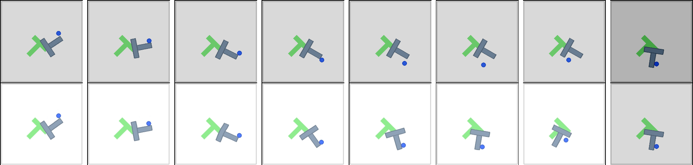

# SCoPe: Trust-Region Latent Planning with JEPA World Models

**Start here.** This is the home page of the project: what it is, what we have measured so far, and
where everything lives. The work is split over three repositories:

| Repository | What is in it |
|---|---|
| **[scope-project](https://github.com/AayuShen/scope-project)** (this one) | Overview, experiment reports, result numbers, key figures |
| [scope-planning](https://github.com/AayuShen/scope-planning) | The code: SCoPe package, DINO-WM runtime patches, run scripts, the H1 pilot |
| [scope-mid-review](https://github.com/AayuShen/scope-mid-review) | The mid-review deck (8 slides + 38-slide backup), PDFs, speaker script, references |

## The project in four sentences

A robot can plan by **imagining** what its actions will do, using a learned **world model**, and then
picking the plan whose imagined result looks closest to the goal. The world model we use is
**DINO-WM**: it turns each camera image into a compact numerical summary using a frozen image encoder
(DINOv2) and predicts how that summary changes after an action. This "predict the summary, not the
pixels" idea is called a **JEPA** (Joint-Embedding Predictive Architecture). The problem: the planner
trusts every imagined future equally, even when the model is confidently wrong, and **SCoPe** adds a
check that scores how reliable each imagined step is and rejects plans that leave the region where
the model can be trusted.

*Push-T, seed 101, episode 0. Top: what really happened in the simulator. Bottom: what DINO-WM imagined
for the same actions. This is the failure SCoPe is meant to catch.*

## What has been done

- **Reproduced DINO-WM on a laptop GPU (8 GB).**
  - Push-T, three random seeds: 0.873 after one plan and 0.900 after replanning. The paper reports 0.86 and 0.90.
  - PointMaze: 0.86 and 1.00, against the paper's 0.80 and 0.98.
  - Wall, three seeds: 0.52 after one plan and 0.95 after replanning, against the paper's 0.74 and 0.96.
- **Made planning 3.8× faster**, with patches that fit the model in 8 GB and were checked not to change any of the planner's choices.
- **Found and logged a failure case.** In one Push-T episode, the model imagines the block reaching the goal, but in the simulator it barely moves. This is the problem SCoPe targets.
- **Designed the experiment that tests SCoPe.** We have the hypotheses, the metrics, the controls and a go/no-go point. We also wrote the code interfaces the trust module will plug into.
- **Ran a pilot of the trust scores (H1) on three seeds.** On 80 Push-T episodes we executed 192 candidate plans each in the simulator and compared the model's imagination with reality: 76,800 imagined steps. The question was whether a score can pick out the 10% of steps with the largest real error, where 0.5 is a coin flip and 1.0 is perfect.
  - MC-dropout scored 0.86 (95% interval 0.84–0.88; 0.87, 0.84 and 0.88 on the three seeds). It runs the predictor four times with dropout on and measures disagreement. It beat both random (0.50) and the trivial "how far did the plan move" baseline (0.79). No training was needed.
  - Replaying a gate offline barely changed which plans succeed: 71% without it, 70% with the MC-dropout gate, and 73% even with a gate that knows the true error. Whether the gate helps must be shown in the closed loop, which is next.
  - Details: [docs/experiments/h1_pilot_trust_scores.md](docs/h1_pilot_trust_scores.md).
- **Prepared the mid-review material:** the slide deck, a speaker script, a references list and a question-and-answer document.

**Not done yet:** the gated planner in the closed loop, and the trust scores in more settings (other start states, visual changes, Wall and PointMaze). So far, the SCoPe-specific result is the offline pilot above.

We are **not training** the world model: every result uses the DINO-WM authors' released checkpoints.

## Open these first

| What | Where |
|---|---|
| **The whole project explained step by step** | [SCoPe_project_guide.pdf](SCoPe_project_guide.pdf) ([Word version](SCoPe_project_guide.docx)) |
| The deck we present (8 slides, PDF) | [scope-mid-review/SCoPe_mid_review.pdf](https://github.com/AayuShen/scope-mid-review/blob/main/SCoPe_mid_review.pdf) |
| What to say on each slide (about 10 minutes) | [scope-mid-review/SCoPe_speaker_script.txt](https://github.com/AayuShen/scope-mid-review/blob/main/SCoPe_speaker_script.txt) |
| Backup deck with every detail (38 slides, PDF) | [scope-mid-review/SCoPe_mid_review_extended.pdf](https://github.com/AayuShen/scope-mid-review/blob/main/SCoPe_mid_review_extended.pdf) |
| How the reproduction was run, with all numbers | [docs/phase0_dino_wm_reproduction.md](docs/phase0_dino_wm_reproduction.md) |
| The trust-score pilot, with all numbers | [docs/h1_pilot_trust_scores.md](docs/h1_pilot_trust_scores.md) |
| The plan for the trust experiments | [docs/phase1_error_logging_and_trust_evaluation.md](docs/phase1_error_logging_and_trust_evaluation.md) |
| Every measured number, machine-readable | [results/](results/) |
| System architecture | [figures/architecture_A_end_to_end.png](figures/architecture_A_end_to_end.png) |
| References with links | [scope-mid-review/references.md](https://github.com/AayuShen/scope-mid-review/blob/main/references.md) |

## Words you will see

| Term | Meaning |
|---|---|
| **Push-T** | A simulated task in which a dot pushes a T-shaped block onto a T-shaped target. Our main test. |
| **Wall** | A simulated task in which a dot walks through a door in a wall to reach a goal. |
| **PointMaze** | A simulated task in which a ball rolls through a maze to reach a goal. |
| **Episode** | One attempt: a start position and a goal. We run 50 per seed. |
| **Seed** | A number that fixes which episodes are picked. Several seeds check that a result is not luck. |
| **CEM** | How the planner searches: it imagines 300 random plans, keeps the best 30, samples new plans around them, and repeats. |
| **MPC / round** | The planner executes the first part of its best plan, looks at the real result, and plans again. One plan-and-execute cycle is one round; we allow at most 3. |
| **Trust score** | A number for each imagined step that says how unreliable the prediction is. In SCoPe, plans with an untrusted step are rejected. |
| **AUROC** | How well a score ranks the truly bad steps above the good ones: 0.5 is a coin flip, 1.0 is perfect. |

## What happens next

1. If a trust score keeps beating both random and the trivial baseline, add the gate to the planner
   and compare it in the closed loop with plain planning, a random gate and an "oracle" gate that
   knows the true error (H4). If no score holds up, we report that as the result.
2. Robustness: the same tests under visual changes, then on Wall and PointMaze.

Paths such as `scripts/…` or `src/…` inside the reports refer to
[scope-planning](https://github.com/AayuShen/scope-planning); `docs/mid_review/…` refers to
[scope-mid-review](https://github.com/AayuShen/scope-mid-review).
